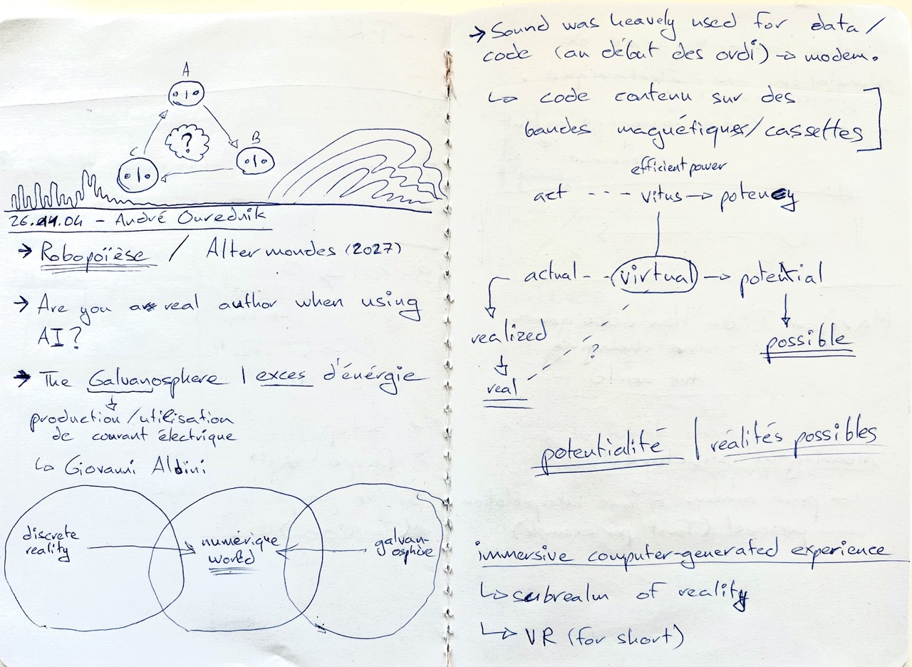
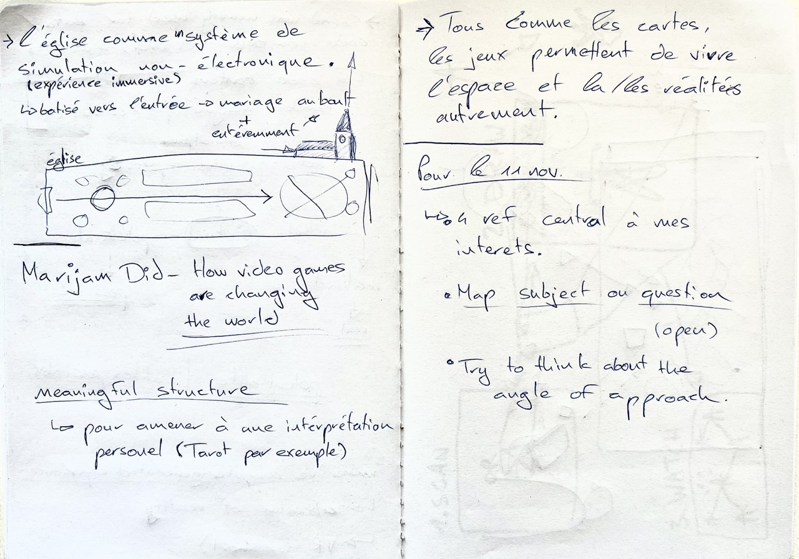

# 𖥋 Process 𖥋

 This folder contains various notes, references, sketches, images, ideas, etc.  
Each entry is dated and arranged in reverse chronological order. 

# 𖨠 26.11.04 -  André Ourednik 𖨠   

[<u>**Alterated Realities and Real Alternatives**</u>](https://ourednik.info/events.php?event=head2026-art-emotions-ai-1)

<u>**Exercice - october 26**</u>

- I am interested in exploring **Sound / Music produce with machine (in the broad sense of the term)**. 
- The context, community, place, material or practice I want to engage with is **Music Production / Sound Design / Machines / Low Tech**. 
- I am curious about the relationship, contradiction or tension between **The Machine** and **S ound**. 
- I think this matters because **Sound is an aspect often considered secondary within digital spaces**. 
- I could investigate this by observing **artists - plugins - video games**, speaking with people **who produce sound on a computer**, collecting or documenting **the various facets of using sound within digital spaces**, or making/prototyping **a VST ? a website ?**. 
- This could help me understand **the importance of sound within digital spaces – why use sound in a space that does not inherently require it?**. 
- My first small experiment could be **A fictional forum centered on sound**

# Assignment - november 11

## 4 Key references:

- [Iglooghost](https://iglooghost.net/)
- [Sisters with Transistors](https://sisterswithtransistors.com/)
- [Vtol](https://vtol.cc/filter/works)
- [Richon-Bender](https://richon-bender.ch/fr/installations)

## Map your subject

[MAP](https://www.figma.com/board/GGSjUsKEXbrpD3xKfX7BkW/Designing-Question?node-id=0-1&t=OnYCyFtBoEU2Vg0N-1)

## Angle of approach

I am not entirely sure about my approach at this stage. I would like to develop a scientific and theoretical investigation into my subject, while remaining equally interested in exploring its poetic dimension. Perhaps there is a way to bring these two approaches together?

# State of the art

- A list of sources / references. 

- A map of theories, projects, practice, methods, (...) that already exists aroud your topic 

    - Don’t hesitate to include a diverse range of references — there’s no need to limit yourself to the field of design.

- It is a way of acting as a curator within the subject matter, in order to take a stance regarding that subject. Ask yourself: <u>where can I make a contribution ?</u>

- The more you focus on something specific (by setting limits), the more the subject will open up. 

- If my topic is too broad, I should ask myself: which aspect of this topic interests me? How do I wish to approach it? What do I want to learn? ...

- Consider the question of the angle of approach: critical? scientific? poetic? (...)

- It’s a good idea to create lists (Arena), but it is extremely important to ask yourself: why does this particular item interest me?

- Identifying the vocabulary and terms related to my topic will help me be specific in my research.

- As you make new discoveries, it is a good idea to document the origins of your references (for your bibliography).

# 𖨠 26.10.14 - Wendy Chun 𖨠   (w/ Alexia Mathieu & Joël Vacheron) 

<u>**Unseeing Space Imagery → Ways of seeing**</u>

Joël s'interesse au rapport que l'on porte avec les images (en particulier l'imagerie spatial) - Pourquoi s'arrêter à l'aspect ésthétique des images et ne pas remettre en question la signification même de cette image.  

Par exemple: Soleil <i>Levant de Monet</i> → Historiquement on retient principalement l'influence ésthétique de cette peinture sur le monde de l'art, alors que cette dernière représente l'impacte de l'ère industriel sur l'environnement. 

L'imagerie spatial créer une forme de distraction - nous ne questionnons plus les conditions de production l'image (prise de vue, montage, décision ésthétique)  

Qui prend la photo ? pourquoi ? comment ? à quelles fins ? 

Peut-on imaginer des possibilitées (points de vue) alternatives ?? 
OUI ! → L'afrofuturisme par exemple [Sun ra, Herbie Hancock, etc.]

## REF

- [Whole Earth Catalog](https://wholeearth.info/)
- [Lisa Messeri](https://www.lisamesseri.com/)
- [Ways of Being](https://jamesbridle.com/books/ways-of-being)

# 𖨠 26.10.07 - Designing questions & reflections 𖨠   (w/ Alexia Mathieu) 

We worked on [exercises](https://hessoit.sharepoint.com/:b:/r/sites/26-27MAMediaDesign/Documents%20partages/md1_%20designing%20questions/Presentations/Wed%2007.10/Designing%20questions_reflections.pdf?d=w09b4cac247b74776a8987bea3f06f15c&csf=1&web=1&e=n6mMdg) proposed by Alexia, focusing on the concepts of fascination, friction, and repetitiveness within our areas of interest.

→ For <u> October 26, 2026 </u>, try to do exercise 5 from the PDF: 

- I am interested in exploring ___. 
- The context, community, place, material or practice I want to engage with is ___. 
- I am curious about the relationship, contradiction or tension between ___ and ___. 
- I think this matters because ___. 
- I could investigate this by observing ___, speaking with ___, collecting or documenting 
___, or making/prototyping ___. 
- This could help me understand ___. 
- My first small experiment could be ___